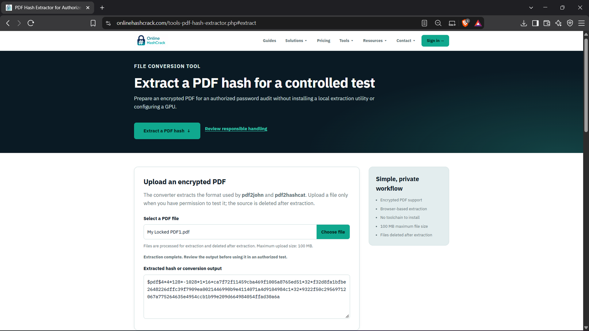
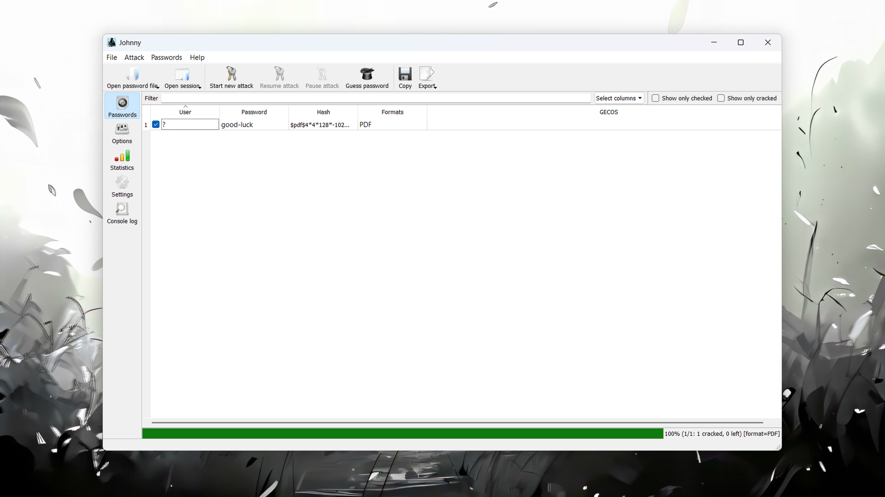
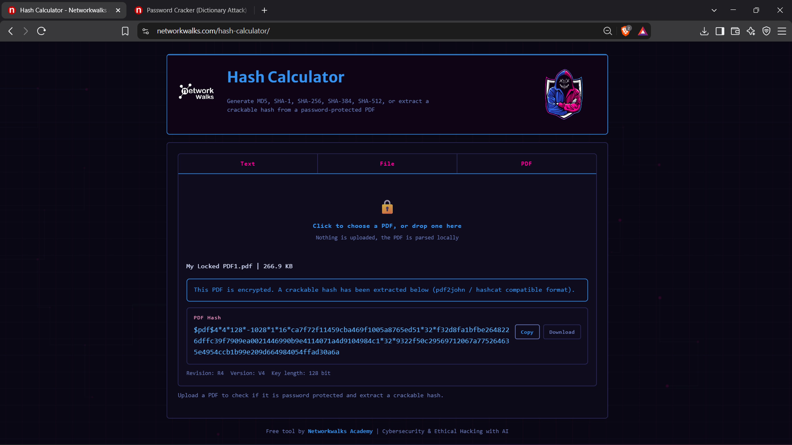
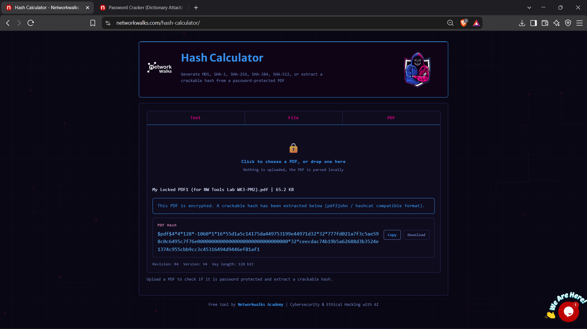
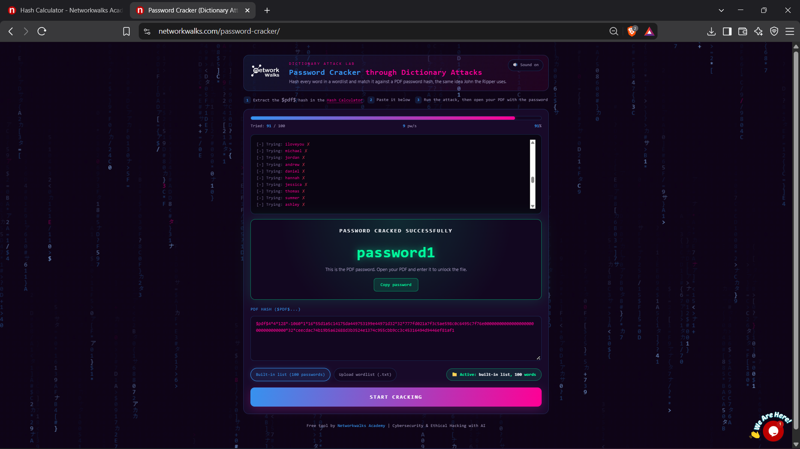

# NetworkWalks B084 | Week 3 - PDF Password Recovery

**Uwes Kulabkar**  |  **Cybersecurity & Ethical Hacking Internship**  |  **Batch B084**  |  **Windows 11**

Practical assessment of password recovery on the institute-provided, encrypted training PDFs. The two compulsory Week 3 modules were completed separately using **John the Ripper with Johnny (W3-PM1)** and **NetworkWalks browser-based tools (W3-PM2)**. The work covers extraction of PDF recovery data, password candidate testing, validation by opening each document, and technical reporting.

**[View the Week 3 Technical Report (PDF)](Final-Report/Week-3-Password-Recovery-Report.pdf)**

## Lab Scope and Verified Results

| Module | Official training file | Workflow | Recovered password | Verification |
| --- | --- | --- | --- | --- |
| **W3-PM1** | `My Locked PDF1.pdf` (266.9 KB) | OnlineHashCrack PDF Hash Extractor → John the Ripper / Johnny | **`good-luck`** | Johnny: **1/1 hashes cracked**; PDF opened |
| **W3-PM2** | `My Locked PDF1 (for NW Tools Lab WK3-PM2).pdf` (65.2 KB) | NetworkWalks Hash Calculator → NetworkWalks Password Cracker | **`password1`** | Built-in dictionary: **91/100 attempts**; PDF opened |

**The two files are different.** PM1 used the larger PDF supplied for the John the Ripper module; PM2 used the dedicated, smaller PDF supplied for the NetworkWalks browser-tools module. Both tasks were performed on November 16, 2026, in an authorized training environment.

## Tools and Environment

| Tool / platform | Practical purpose |
| --- | --- |
| **John the Ripper (Jumbo)** | Offline password candidate verification against PDF recovery data |
| **Johnny GUI** | Import PDF hash, run John the Ripper, review the cracked-password result |
| **OnlineHashCrack PDF Hash Extractor** | Extract the PM1 `$pdf$` recovery string in John-compatible form |
| **NetworkWalks Hash Calculator** | Extract `$pdf$` recovery data from the PM2-specific encrypted PDF |
| **NetworkWalks Password Cracker** | Run a controlled, browser-based wordlist/dictionary attack |
| **Windows 11 / Brave and Microsoft Edge** | Local lab environment, browser tools, and PDF access verification |

## W3-PM1 | Password Cracking with John the Ripper

**Target:** `My Locked PDF1.pdf` (approximately 266.9 KB)  
**Objective:** Recover the training PDF password locally with John the Ripper and verify access.

### 1. Extract the PDF recovery hash

Opened the [OnlineHashCrack PDF Hash Extractor](https://www.onlinehashcrack.com/tools-pdf-hash-extractor.php), selected the PM1 training file, and extracted its `$pdf$` recovery data. The value was prepared as a single line for import into Johnny. This string represents the PDF's password-verification information; it is not the plaintext password.

### 2. Recover the password through Johnny

Configured Johnny to use the local John the Ripper executable, loaded the PDF recovery data, and ran the password-recovery process. The results show **one PDF hash loaded and one password recovered**.

**Verified password: `good-luck`**

### 3. Verify document access

Opened the corresponding encrypted PM1 file with the recovered password. The PDF displayed the institute's completion page and flag, confirming successful access to the intended training document.

### Additional controlled cross-check

The same *larger PM1 document* was also tested with the NetworkWalks browser utilities. The Hash Calculator identified the encrypted PDF and the Password Cracker recovered `good-luck` using an **uploaded 28-word dictionary**. This is supplementary verification and **is not substituted for the compulsory PM2 exercise**.

**[Read PM1 technical findings](W3-PM1-John-the-Ripper/findings.md)**

## W3-PM2 | Password Cracking with NetworkWalks Tools

**Target:** `My Locked PDF1 (for NW Tools Lab WK3-PM2).pdf` (approximately 65.2 KB)  
**Objective:** Recover the password using NetworkWalks' PDF Hash Calculator and dictionary-based Password Cracker.

### 1. Extract the PM2-specific PDF hash

In the [NetworkWalks Hash Calculator](https://networkwalks.com/hash-calculator/), selected the **PDF** tab and opened the dedicated PM2 training file. The tool extracted a `$pdf$` string and reported **PDF Revision R4, Version V4, and 128-bit key length**.

### 2. Run the built-in dictionary attack

Pasted the complete `$pdf$` recovery string into the [NetworkWalks Password Cracker](https://networkwalks.com/password-cracker/), used the **built-in 100-password list**, and ran the exercise. The tool reported a successful match after **91 attempts**.

**Verified password: `password1`**

### 3. Verify document access

Opened the **PM2-specific PDF** with `password1` and confirmed that its completion page and flag were displayed. This confirms that the recovered password corresponds to the correct institute training file.

**[Read PM2 technical findings](W3-PM2-NetworkWalks-Tools/findings.md)**

## Technical Observations

- **Weak passwords were recoverable in these controlled exercises.** Both training documents accepted passwords found through candidate testing; the results do not indicate any defect in PDF encryption itself.
- **PDF recovery strings are structured verifier data.** A `$pdf$` string contains information needed to test password candidates against the encrypted document; it should not be confused with a generic file checksum.
- **Attack success depends on tested candidates.** The PM2 built-in list recovered `password1` on candidate 91; the separate PM1 cross-check used a 28-word uploaded list for `good-luck`.
- **Separate test inputs matter.** Although both documents have a similar PDF1 name, they contain different encryption verifier data and require their own testing and evidence.

For sensitive documents, prefer **long, unique passphrases**, use current encryption settings supported by the PDF software, and protect any recovered credentials and exported hashes. The results here are specific to the supplied training files, not to a live external system.

## Documentation

- [PM1 findings - John the Ripper and supplementary cross-check](W3-PM1-John-the-Ripper/findings.md)
- [PM2 findings - NetworkWalks browser tools](W3-PM2-NetworkWalks-Tools/findings.md)
- [Week 3 Technical Report (PDF)](Final-Report/Week-3-Password-Recovery-Report.pdf)

**References:** NetworkWalks institute materials: *Week3 Projects v1*, *W3-PM1 - Password Cracking with JTR v1*, and *W3-PM2 - Password Cracking with NW Tools v1*. Original training PDFs are not redistributed in this repository.
